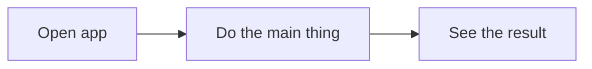

# Product spec

## Problem

Who has the problem, what it is, and what they do about it today.

## Users

The one or two kinds of people this is for.

## Core flow

The single path through the app that must work for the product to be worth anything. The smoke test covers exactly this.

## Screens

| Screen | Purpose | Main actions |
|---|---|---|

## Data model

| Entity | Fields | Notes |
|---|---|---|

## Out of scope

What this version deliberately does not do.

## Open questions

Anything undecided. Must be empty before planning starts.
