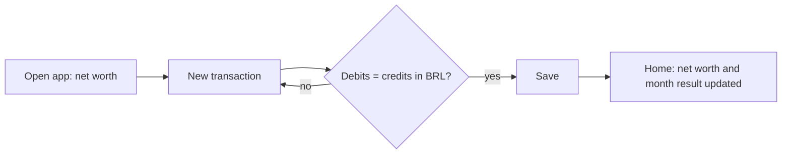

# Product spec

## Problem

People with money spread across accounts, currencies and assets (checking, USD, bitcoin, investments, debts) cannot see their real net worth or explain where each change came from. The author uses a budgeting app that locks everything to BRL, so USD and BTC accounts are not modelled. It also cannot record a transaction with more than two sides, such as one credit split across several debits. Spreadsheets allow both but do not enforce that debits equal credits. The author needs a ledger that does.

## Users

One person: the author, for personal use. Other users may come later, but this version has no accounts, login or sync (see [[ADR-0003-local-first-sqlite-storage]]).

## Core flow

The one path that must work. The smoke test covers exactly this.

1. Open the app and see net worth in BRL.
2. Tap "New transaction", enter date and description, and add postings (account, debit or credit, amount, currency).
3. The app saves only when debits equal credits in BRL. Example: one credit of R$ 1,000 on Checking split across three debits (Groceries, Transport, Leisure).
4. Return to Home and see the updated net worth and the month result.



## Screens

The UI is in English. The main amount is always the BRL value. The original currency amount appears smaller and muted, only when the currency is not BRL. Minimal but efficient: more with less.

| Screen | Purpose | Main actions |
|---|---|---|
| Home | Net worth in BRL, result of the current month, balances by currency | Open New transaction, open Accounts, see last backup date and a warning when it is older than 30 days |
| New transaction | Record a transaction with N postings | Set date and description, add or remove postings (account, debit or credit, amount, currency), edit the BRL value of a posting to absorb rounding, save only when balanced |
| Transactions | History | Filter by period and account, open, edit or delete a transaction (an edit or delete must keep every transaction balanced) |
| Accounts | Chart of accounts (asset, liability, equity, income, expense), each with one currency | Create, rename or archive an account, see balance and statement, adjust value of a foreign-currency account |
| Rates | Simple input page for manual exchange rates against BRL | Add a rate (currency, BRL per unit, date), see how old each rate is. Rates prefill new postings |
| Result | Income statement: income, expenses and result, grouped by account | Choose a period (month, year, custom range) |
| Settings | Data safety and import | Import CSV, export backup, import backup |

## Data model

| Entity | Fields | Notes |
|---|---|---|
| Currency | code, name, decimals | BRL is the base currency and cannot change. BRL and USD have 2 decimals, BTC has 8 |
| Account | id, name, type (asset, liability, equity, income, expense), currency, archived | Currency is fixed per account |
| Transaction | id, date, description | Groups postings. Must balance |
| Posting | id, transaction, account, side (debit or credit), amount, rate, amount in BRL | Amount is an integer in the minor unit of the account currency. For BRL accounts the BRL amount equals the amount. A foreign-currency posting may have amount 0 and a non-zero BRL amount: a value adjustment ([[ADR-0010-net-worth-from-ledger]]) |
| Rate | currency, date, BRL per unit | History is kept. Used to prefill postings, never to compute net worth |

Rules:

- A transaction balances when the sum of debit BRL amounts equals the sum of credit BRL amounts ([[ADR-0009-balance-invariant]]).
- Net worth is assets minus liabilities, summed from posting BRL amounts. It is the ledger value, not a market value ([[ADR-0010-net-worth-from-ledger]]).
- The Result screen shows income minus expenses over the chosen period. Currency gains and losses are income or expense accounts, filled by ordinary transactions the author posts by hand.
- Money is integers in the minor unit, ids are UUIDs ([[ADR-0007-integer-money]], [[ADR-0008-uuid-identifiers]]).
- Data lives on the device in SQLite. Reinstalling the app erases it, so the backup file is the safety net ([[ADR-0003-local-first-sqlite-storage]], [[ADR-0011-backup-and-csv-import]]).
- Backup: export one JSON file with everything, import restores it. Home shows the date of the last export.
- CSV import: one file, one row per posting, grouped by `transaction_id`. All or nothing, idempotent by `transaction_id`, with a preview before writing.

```
transaction_id,date,description,account,account_type,side,amount,currency,rate_to_brl
t-0001,2026-09-05,Supermarket,Checking,asset,credit,300.00,BRL,
t-0001,2026-09-05,Supermarket,Groceries,expense,debit,300.00,BRL,
t-0002,2026-09-06,Buy BTC,Crypto,asset,debit,0.00500000,BTC,350000
t-0002,2026-09-06,Buy BTC,Checking,asset,credit,1750.00,BRL,
```

## Out of scope

- Multiple users, login, cloud, sync between devices.
- Automatic exchange rates, automatic month-end close or revaluation. Rates and currency gains are entered by hand.
- Bank connections (Open Finance) and receipt scanning.
- Budgets, goals, recurring transactions, reminders.
- Charts. This version shows numbers and tables.
- Balance sheet and cash flow reports. Net worth and account balances cover it.
- A base currency other than BRL.
- Reversal entries and audit trail. Editing and deleting are free as long as every transaction stays balanced.
- Cost basis and realised gains of investments.
- App lock, push notifications, tablet or desktop layouts, store submission.

## Open questions

